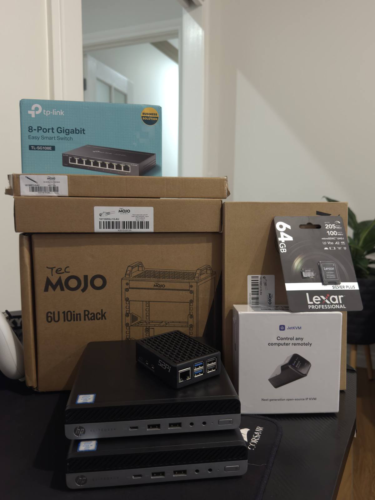

# Segmented Security Homelab

A 6U rack-mounted homelab built to learn network segmentation, firewalling and monitoring on real hardware. It runs a pfSense firewall, a Proxmox host for attack and defence VMs, a VLAN-capable switch and a Raspberry Pi for services, with out-of-band management through a JetKVM.



## Goals

- Segment the network into zones with VLANs and firewall rules
- Run attacker and vulnerable VMs in an isolated lab
- Collect logs and detect attacks (SIEM)
- Remote access without port forwarding
- Document the whole build, including mistakes

## Status

| Step | Status |
|------|--------|
| Parts ordered and delivered | Done |
| Rack assembled | Done |
| HP BIOS setup (virtualization, boot, power) | Done |
| pfSense install, WAN on a tagged VLAN, LAN, DHCP and DNS | Done |
| Internal VLANs (10/20/30/99), DHCP and default-deny firewall rules | Done, tested per zone |
| Pi rebuild: Docker, Plex, Samba on the Trusted VLAN | Done, reboot-tested |
| Tailscale, Vaultwarden (restore-tested backup), Uptime Kuma, SSH hardening | Done |
| Move my PC onto the Trusted VLAN | Planned |
| Proxmox on a trunk port and lab VMs | Planned |
| Wazuh detection | Planned |

## Rack layout (6U, 10")

| U | Device |
|---|--------|
| 6 | HP EliteDesk 800 G3 Mini, pfSense firewall |
| 5 | HP EliteDesk 800 G3 Mini, Proxmox host |
| 4 | Patch panel (0.5U) + brush panel (0.5U) |
| 3 | TP-Link TL-SG108E switch + JetKVM (custom 3D-printed 1U plate) |
| 2 | Raspberry Pi 5 shelf |
| 1 | Spare |

The power board sits at the bottom or back. Power bricks are strapped at the back and the media drive is stuck to the rear.

## Network design

```
Internet -> Deco -> TL-SG108E (WAN VLAN 2) -> pfSense (one NIC, trunk) -> TL-SG108E (LAN) -> devices
```

The firewall has a single onboard NIC, so it runs as a "router on a stick". One cable carries both networks as VLANs:

| Switch port | Device | VLAN membership |
|-------------|--------|-----------------|
| 1 | Deco uplink | 2 (WAN), untagged |
| 2 | pfSense trunk | 1 untagged (LAN), 2 tagged (WAN) |
| 2 (also) | pfSense trunk | 10, 20, 30, 99 tagged |
| 4 | Raspberry Pi 5 | 10 (Trusted), untagged |
| 7 | Test port | Moved between VLANs to test each zone |
| 3, 5, 6, 8 | Spare / my PC | 1 untagged for now |

pfSense maps the WAN to `em0.2` and the LAN to `em0` (192.168.1.0/24). The internal VLANs run as tagged sub-interfaces on the same trunk.

| Zone | VLAN ID | Subnet | Purpose |
|------|---------|--------|---------|
| Trusted | 10 | 192.168.10.0/24 | Personal devices and the Pi |
| Lab | 20 | 192.168.20.0/24 | Proxmox VMs (Kali, vulnerable targets) |
| IoT / DMZ | 30 | 192.168.30.0/24 | Anything exposed or untrusted |
| Management | 99 | 192.168.99.0/24 | JetKVM and admin interfaces |

### Firewall policy

Each zone is default-deny. pfSense reads rules top to bottom and the first match wins, so every zone follows the same pattern:

| Zone | Rules, in order |
|------|-----------------|
| IoT, Lab | Allow DNS to pfSense, block everything to private networks, allow the rest (internet only) |
| Management | Allow DNS, block private networks, allow NTP (UDP 123) and HTTPS (TCP 443) out |
| Trusted | Allow all. Nothing in other zones can start a connection back in |

The "private networks" rule uses one alias (`PRIVATE_NETS`: 10.0.0.0/8, 172.16.0.0/12, 192.168.0.0/16), so it's edited in one place. I tested each zone from a laptop on the test port: the internet works, and ping to other zones and to the firewall's own address fails.

- The TL-SG108E is an "Easy Smart" managed switch. Unmanaged switches can't do VLANs.
- Cable colour coding uses white cables with coloured labels: green trusted, blue lab, orange IoT/DMZ, grey uplink.
- Firewall rules are documented in [`docs/security.md`](docs/security.md).

## Hardware

| Part | Role |
|------|------|
| 2 × HP EliteDesk 800 G3 Mini (i5-6500T, 8GB, 256GB) | Firewall and Proxmox host |
| TP-Link TL-SG108E | VLAN switch |
| Raspberry Pi 5 (4GB) | Plex, Samba, Uptime Kuma, Tailscale, Vaultwarden |
| JetKVM | Remote console and BIOS access, on the management VLAN |
| Tecmojo 6U 10" rack + 12-port patch panel + brush panels | Enclosure and cable management |

## Software

- **Firewall:** pfSense (routing, NAT, rules, VLAN interfaces)
- **Hypervisor:** Proxmox VE (Kali, Metasploitable/DVWA, SIEM)
- **Pi:** Raspberry Pi OS Lite (64-bit), Docker Compose, Plex, Samba, Vaultwarden, Uptime Kuma
- **Remote access:** Tailscale to reach the Pi's services, nothing exposed to the internet. A subnet router with ACLs is planned.
- **Planned:** Wazuh for detection, 16GB RAM upgrade for Proxmox

## Services on the Pi

The Pi sits on the Trusted VLAN with a static DHCP reservation, so its address never changes.

- **Storage:** a 1.8 TB ext4 drive is mounted by UUID in `/etc/fstab` with `nofail`, so the Pi still boots if the drive is unplugged.
- **Plex:** runs in Docker Compose with host networking. The media folders are mounted into the container read-only (`:ro`), so Plex can't change or delete anything. Plex's database lives on the drive, which avoids wearing out the SD card.
- **Samba:** shares only the movies and shows folders, with a user login. `hosts allow` limits access to my own subnets, so the Lab and IoT zones can't reach the shares.
- **Secrets:** tokens and passwords are in `.env` files that are never committed. Each project commits a `.env.example` instead.
- **Reboot test:** after a restart the drive, Docker, Plex and Samba all come back on their own.
- **Tailscale:** installed on the Pi and my PC for remote access. No router ports are opened for it.
- **Vaultwarden:** self-hosted password manager in Docker. It listens on localhost only and is published to my Tailscale network over HTTPS with `tailscale serve`. Sign-ups are off. A nightly script makes an encrypted backup (SQLite `.backup`, then GPG AES-256), and I restore-tested it into a throwaway container before putting real passwords in.
- **Uptime Kuma:** checks pfSense, the Deco, internet reachability, DNS, Plex and Samba every minute. Its data lives on the drive instead of the SD card to avoid wear.
- **SSH:** key-only login, password and root login off, 3 attempts per connection, only my own user allowed.
- **Plex port forward:** the only forward on the firewall. It accepts TCP 32400 from the home Wi-Fi (Deco) subnet only and sends it to the Pi. See problem 4.

## Problems I hit

**1. A USB Ethernet adapter made the WAN unreliable.**
- The plan was a USB3 adapter as the second NIC. After a pfSense update, the WAN lost its address and the link kept flapping.
- I first blamed the update. Checking `dmesg` and `usbconfig` showed the link going up and down on the adapter itself.
- Different USB ports, forced 100 Mbps and disabling offload didn't help. Reinstalling the older pfSense version still flapped, which ruled out the update.
- **Fix:** drop the adapter and use router-on-a-stick, with the WAN as a tagged VLAN on the onboard Intel NIC. Zero errors since.
- **Lesson:** change one variable at a time, and test the hardware before blaming the software.

**2. New VLANs could reach pfSense but DNS was refused.**
- Clients on the new VLANs got an address and had internet by IP, but every DNS lookup returned `REFUSED`.
- `REFUSED` (not a timeout or NXDOMAIN) meant the firewall rule was fine and Unbound's own access list was rejecting the clients.
- **Fix:** add an explicit Unbound access list entry for each internal subnet, apply, and restart the resolver.
- **Lesson:** the status code tells you which layer to blame. Also, after moving a switch port to a new VLAN the link stays up, so the client keeps its old lease until you renew it.

**3. Plex played at low quality on the home Wi-Fi.**
- TVs and phones on the Deco network were slow to load and stuck at about 420p.
- The Plex dashboard showed the Apple TV's connection as `Indirect` at about 1 Mbps, and a 1080p HEVC file was being transcoded down. That meant the stream was going through Plex's internet relay.
- The Deco sits upstream of pfSense, so Plex can't treat those devices as local. The Pi 5 can't hardware transcode either, so it couldn't keep up with the relay's cap.
- **Fix:** reserve pfSense's WAN address on the Deco, forward TCP 32400 from the Deco subnet only to the Pi, set a custom server access URL in Plex, and turn Relay off so clients use the direct route.
- **Lesson:** read the dashboard before changing settings. `Indirect` pointed straight at the relay instead of the network or the file.

## What it demonstrates

- Network segmentation with VLANs and inter-zone firewall rules
- Safe, isolated attack and defence practice
- Self-hosting with remote access that doesn't expose the home network
- Documenting a build honestly, mistakes included

| IoT, Lab | Allow DNS to pfSense, block everything to private networks, allow the rest (internet only) |
| Management | Allow DNS, block private networks, allow NTP (UDP 123) and HTTPS (TCP 443) out |
| Trusted | Allow all. Nothing in other zones can start a connection back in |

The "private networks" rule uses one alias (`PRIVATE_NETS`: 10.0.0.0/8, 172.16.0.0/12, 192.168.0.0/16), so it's edited in one place. I tested each zone from a laptop on the test port: the internet works, and ping to other zones and to the firewall's own address fails.

- The TL-SG108E is an "Easy Smart" managed switch. Unmanaged switches can't do VLANs.
- Cable colour coding uses white cables with coloured labels: green trusted, blue lab, orange IoT/DMZ, grey uplink.
- Firewall rules are documented in [`docs/security.md`](docs/security.md).
